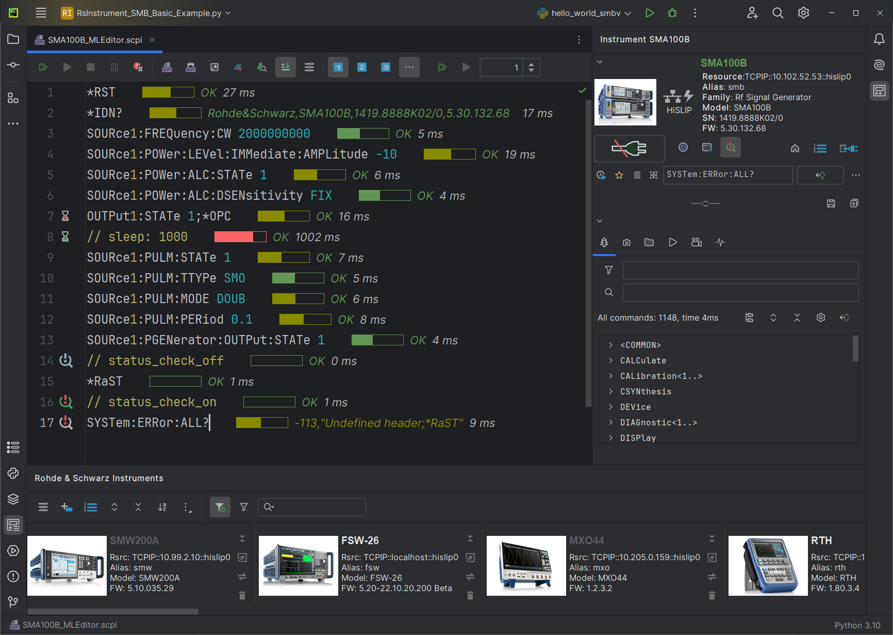

RsIC Documentation
===================

**RsIC** (Rohde & Schwarz Instrument Control) is a PyCharm plugin for writing
and debugging instrument remote-control scripts. It keeps your instruments,
SCPI, and Python in one IDE. It works especially well with the
`RsInstrument <https://pypi.org/project/RsInstrument/>`_ package, but you can
use it with other Python VISA stacks as well.

**What you can do:**

- **Instrument list** — aliases, session type, and identity for every device.
- **SCPI communicator** — connect, send a query, keep history and favorites.
- **SCPI editor** — syntax check, completion, run the file, a selection, or a single line (F5 / F4).
- **SCPI tree** — read the commands your firmware actually supports (cached; drives completion).
- **SCPI recorder** — operate the instrument locally and capture the matching SCPI (`video <https://youtu.be/pURxIsOwRBI>`_).
- **Python assistance** — completion, command search, drag-and-drop, paste from IO traces.
- **Hardcopy, file browser, macros, curves** — screenshot, Ctrl+C/V file transfer, one-click Python macros, trace plots.

Five minutes from install to a three-line script: :doc:`Chapter_GettingStarted`.

SCPI Recorder:

.. raw:: html

    <iframe width="560" height="315" src="https://www.youtube.com/embed/pURxIsOwRBI?rel=0" frameborder="0" allowfullscreen></iframe>

.. toctree::
   :maxdepth: 2
   :caption: Contents

   Chapter_GettingStarted
   Chapter_02_Installation
   Chapter_04_AddingFirstInstrument
   Chapter_05_InstrumentsPanelList
   Chapter_06_InstrumentsToolWindow
   Chapter_07_FunctionPanel_ScpiTree
   Chapter_08_FunctionPanel_Hardcopy
   Chapter_09_FunctionPanel_FileBrowser
   Chapter_10_FunctionPanel_Macros
   Chapter_11_FunctionPanel_ScpiRecorder
   Chapter_12_FunctionPanel_Curves
   Chapter_13_PlainScpiScripts
   Chapter_14_WritingPythonScripts
   Chapter_15_AdvancedScpiParser
   Chapter_16_PluginSettings

.. toctree::
   :maxdepth: 1
   :caption: Release notes

   Changelog
